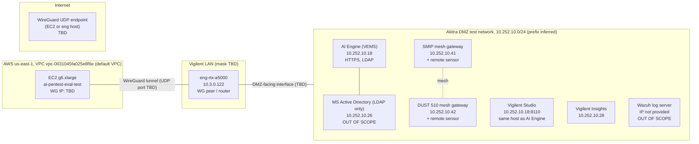

# Network path: AWS test instance to Akitra DMZ via eng-rtx-a5000

**Status:** Draft. Remaining unknowns are marked `TBD`.
**Exercise:** Blue team exercise. Sponsor: CISO (Vigilent).
**Scope:** Path from the AWS EC2 test instance (`ai-pentest-eval-test`) to the Akitra DMZ test network, through `eng-rtx-a5000`, which already reaches the DMZ.

## 1. Diagram

Notes on the diagram:

- The tunnel is point-to-point between the EC2 instance and `eng-rtx-a5000`. Traffic from the instance to the DMZ passes through the eng host.
- `WireGuard UDP endpoint` is the side that accepts the inbound connection. If `eng-rtx-a5000` sits behind NAT, the EC2 instance must be the endpoint, so it needs a public IP and the WireGuard port is reachable from the internet.
- The DMZ prefix `/24` is inferred from the host addresses. The exercise document does not state it.
- Solid arrows are confirmed by the repo or the exercise document. The eng host's DMZ-facing interface and the WireGuard endpoint are not documented.

## 2. DMZ inventory (from the Akitra exercise description)

| Host | IP | Role | In scope | Notes |
|---|---|---|---|---|
| AI Engine (VEMS) VM | 10.252.10.18 | Virtual machine running AI Engine, HTTPS, LDAP configured | Yes | Login via AI Engine GUI |
| Vigilent Studio | 10.252.10.18:8110 | Runs on the same server as AI Engine | Yes | Admin and dashboard accounts |
| Vigilent Insights VM | 10.252.10.28 | Insights GUI, GraphQL API | Yes | Admin and user accounts |
| SMIP network gateway | 10.252.10.41 | Simple Mesh IP gateway, with a remote sensor on the mesh | Yes | Linux-like OS (Busybody) |
| DUST 510 mesh gateway | 10.252.10.42 | Mesh network gateway, with a remote sensor on the mesh | Yes | Linux and CLI access |
| Wazuh log server | not provided | Third-party log server | No | Outside the penetration test scope |
| MS Active Directory (LDAP) | 10.252.10.26 | LDAP authentication only | No | Outside the penetration test scope |

Access to these hosts requires VPN credentials, which the exercise document says are "forthcoming."

## 3. Confirmed facts

| Item | Value | Source |
|---|---|---|
| eng server | `eng-rtx-a5000`, 10.3.0.122 | `CLAUDE.md` (VigilentSupport_Security_AI, Deployment Model) |
| DMZ test network | 10.252.10.0/24 hosts listed in section 2 | Akitra exercise description |
| AWS test VPC | `vpc-0031045fa025e8f6e` (default VPC) | `terraform/aws-test` plan, 2026-11-05 |
| Instance AMI | `ami-0846639209ba40084` | `terraform/aws-test/main.tf` |
| Inference SG ingress | TCP 8000 from `10.0.0.0/8` | `terraform/modules/aws_ec2/main.tf` default |
| Akitra | Penetration testing vendor. Attestation dated 27 July 2026. | `Vigilent 2026 Security Attestation` in `docdepot` |

## 4. Unknown values

| Item | Needed for |
|---|---|
| Which `eng-rtx-a5000` interface reaches 10.252.10.0/24 | Routes on both sides |
| LAN mask for 10.3.0.0 | Route summarization, firewall rules |
| Where WireGuard terminates (EC2 or eng host) and its public endpoint | Whether the instance needs a public IP |
| WireGuard UDP port | Security group and host firewall |
| VPN credentials for the DMZ | Access to in-scope hosts, forthcoming per exercise document |
| Allowed flows (src, dst, ports) from the instance to the DMZ | Firewall policy, blue team detection rules |
| Whether the DMZ can initiate traffic back to the instance | Default-deny rules |

## 5. Blue team review points

These are design risks. They are not confirmed findings.

1. **Inference SG is too open for this path.** The default ingress allows TCP 8000 from `10.0.0.0/8`. That range includes the DMZ `10.252.10.0/24`. Restrict the source to the WireGuard peer only.
2. **Pivot through a DMZ-connected host.** Compromise of the instance gives a route into the DMZ through `eng-rtx-a5000`. Apply deny-by-default on the eng host, allow only the specific DMZ flows, and log them.
3. **Out-of-scope hosts reachable from the path.** The AD LDAP server (10.252.10.26) and the Wazuh log server are out of scope. Block the path to them from the instance.
4. **Public IP on the instance.** The test root sets `associate_public_ip = true`. If WireGuard terminates on the instance, it is internet-facing on the WireGuard port only.
5. **Keys and tunnel material.** WireGuard keys must not be stored in plaintext on the instance. Use AWS Secrets Manager, per the PRD.
6. **Logging.** Enable VPC Flow Logs on the test VPC, and firewall logging on `eng-rtx-a5000`, so the path can be audited.
7. **Credentials exposed in chat.** The exercise document lists plaintext passwords and API tokens for AI Engine, Vigilent Studio, Insights, DUST 510, and SMIP. They were pasted into a chat session. They are not in this document. Rotate them after the exercise, and store the current ones in a secrets manager, not in git.
